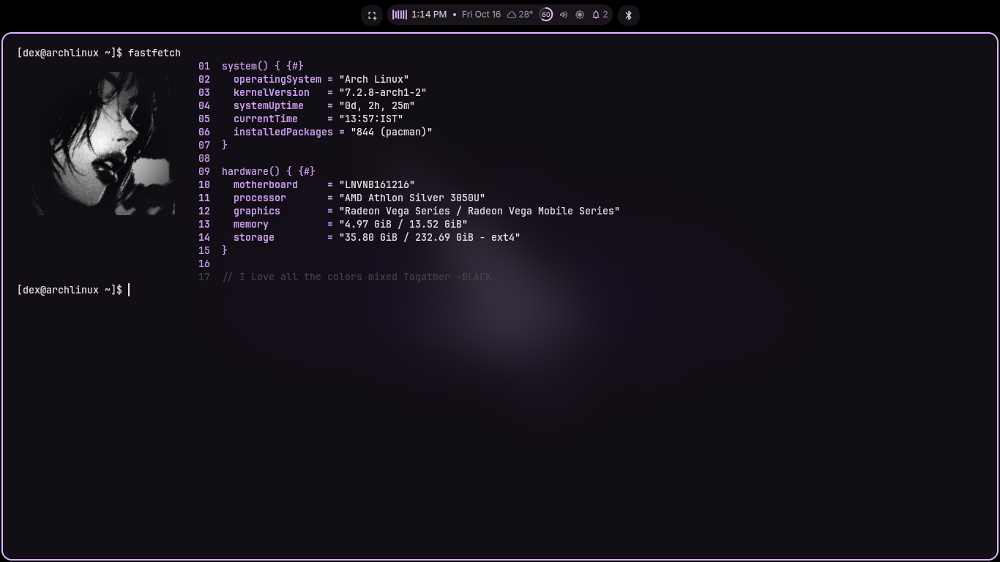

# Code-Style Fastfetch Configuration

A minimal C/C++ pseudo-code configuration layout for Fastfetch.

## Preview



```
01  system() { {#}
02    operatingSystem = "Arch Linux"
03    kernelVersion   = "7.2.8-arch1-2"
04    systemUptime    = "8d, 2h, 25m"
05    currentTime     = "13:57:IST"
06    installedPackages = "844 (pacman)"
07  }
08  
09  hardware() { {#}
10    motherboard     = "LNVNB161216"
11    processor       = "AMD Athlon Silver 3050U"
12    graphics        = "Radeon Vega Series / Radeon Vega Mobile Series"
13    memory          = "4.97 GiB / 13.52 GiB"
14    storage         = "35.80 GiB / 232.69 GiB - ext4"
15  }
16  
17  // I Love all the colors mixed Together -BLACK
```

## Installation

### Arch Linux

```
sudo pacman -S fastfetch
```

### Ubuntu / Debian

For Ubuntu 24.04 LTS and newer:

```
sudo apt update
sudo apt install fastfetch
```

For older Ubuntu versions, use the official PPA:

```
sudo add-apt-repository ppa:zhangsongcui3371/fastfetch
sudo apt update
sudo apt install fastfetch
```

### Fedora

```
sudo dnf install fastfetch
```

### Void Linux

```
sudo xbps-install -S fastfetch
```

### Alpine Linux

```
sudo apk add fastfetch
```

### Gentoo

```
sudo emerge --ask app-misc/fastfetch
```

## Setup Instructions

### 1. Clone or Download the Configuration

Create the fastfetch configuration directory if it does not already exist:

```
mkdir -p ~/.config/fastfetch
```

Clone this repository or copy `config.jsonc` directly into your configuration folder:

```
cp config.jsonc ~/.config/fastfetch/config.jsonc
```

### 2. Configure Logo (Optional)

To display a custom image on the left (supported by graphics-enabled terminals like Kitty, WezTerm, Ghostty, or Foot):

1. Save your image (e.g., `logo.png`) inside `~/.config/fastfetch/`.

2. Open `~/.config/fastfetch/config.jsonc`.

3. Add the `logo` configuration block at the top of the file:

```json
{
  "$schema": "https://github.com/fastfetch-cli/fastfetch/raw/dev/doc/json_schema.json",
  "logo": {
    "type": "kitty",
    "source": "~/.config/fastfetch/logo.png",
    "width": 25,
    "height": 12,
    "padding": {
      "right": 4
    }
  },
  "display": {
    "separator": " = "
  }
}
```

## Usage

Run Fastfetch in your terminal:

```
fastfetch
```

To run fastfetch automatically on terminal launch, append `fastfetch` to the end of your shell startup file (`~/.bashrc`, `~/.zshrc`, or `~/.config/fish/config.fish`).
=======
